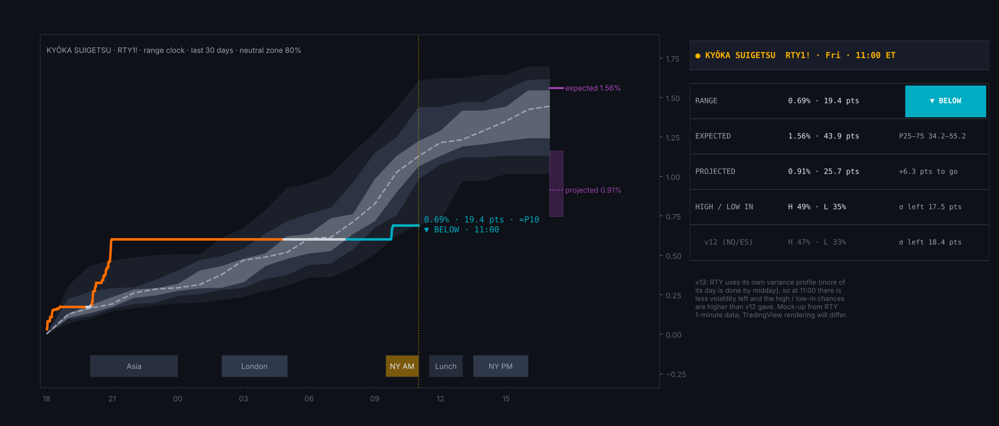
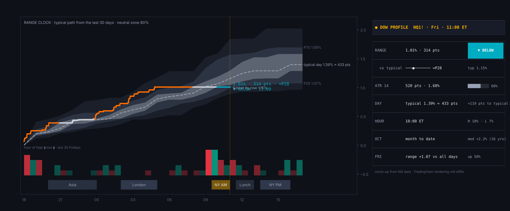
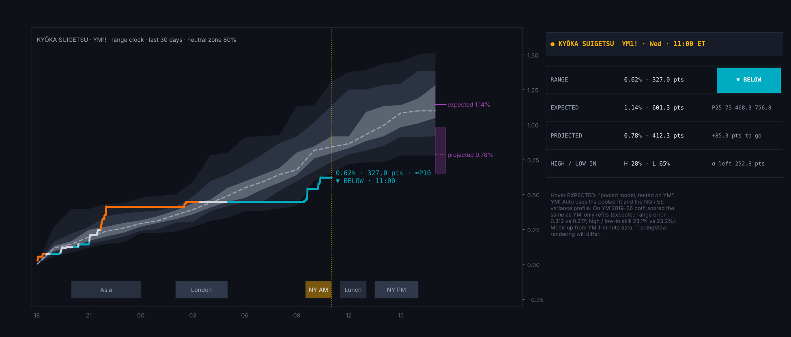

# Kyōka Suigetsu

**Range clock, weekday / hour / month distributions and expected range for NQ, ES, RTY and YM**

TradingView indicator, Pine Script v6. Open source under the Mozilla Public License 2.0.

*Mock-up of how it looks on the chart.*

**Kyōka Suigetsu** (鏡花水月, "Mirror Flower, Water Moon") is named for Sōsuke Aizen's zanpakutō, whose complete hypnosis rules what you perceive. This one works the other way: it shows what is actually typical for this hour, weekday and month, so the day you think you are seeing can be checked against the days that really happened.

It runs in its own pane, on the full trading day (18:00–17:00 ET).

## What it shows

- **Range clock:** today's running range (or net move from the 18:00 open) drawn live against the typical path for each hour of the trading day.
  - The typical path has a median, 25–75 and 10–90 bands, and a neutral zone (the uncertainty of the median).
  - Today's line is coloured by where it sits: above, inside or below the neutral zone.
  - Beneath it, the hour-of-high / low histogram and the session strip share the same time axis.
- **Distributions:** weekday columns, the hour-of-high / low profile and month-of-year seasonality, with every day or year as a dot.
- **Expected range:** today's range forecast from:
  - the last 1, 5 and 22 days' ranges, anchored to the past year;
  - yesterday's move;
  - inside days, holidays, opex Friday and the turn of the month.
  It was fitted on NQ, ES and RTY 2010–2026. YM uses the pooled fit: on YM 2019–26 it beat the typical day in 8/8 years with 16.5% less error, and scored better than a YM-only fit (0.312 vs 0.317).
  - A live projection blends the forecast with the range made so far, hour by hour.
  - The chance today's high or low is already in comes from how far price is from them and how much of the day's volatility is still to come. Tested 2025–26 it was well calibrated, and 23–25% sharper than the plain base rate for the hour (NQ 25%, ES 23%, RTY 25%, YM 23%). It needs a chart of 60 minutes or lower.
- **Cards:**
  - **status:** range, ATR, expected and projected range, high / low in, net, hour, month, weekday;
  - **weekdays**, **months** and **hours**.

## How to use

- Built for CME index futures on continuous charts: **NQ1!**, **ES1!**, **RTY1!** and **YM1!**. RTY uses its own profile. YM uses the pooled fit and the NQ / ES profile, both tested on YM.
- Intraday charts; the live projection and the high / low odds need 60 minutes or lower.

## Credits

- The distribution column layout was inspired by "Day Of Week Price Distribution" by LuxAlgo (CC BY-NC-SA 4.0).
- Written from scratch; no LuxAlgo code is used.

## Add it to TradingView

1. In TradingView, open the **Pine Editor** (bottom panel).
2. Copy the contents of `Kyoka_Suigetsu.pine` into a new script.
3. **Save**, then **Add to chart**.

## More screenshots

*YM1!, Wed 28 Oct 2026 at 11:00 ET: the pooled expected range and the NQ / ES variance profile.*

## License

Mozilla Public License 2.0, see [LICENSE](LICENSE). © Unclehk2000.

*Historical frequencies, not guarantees. Nothing here is financial advice.*
